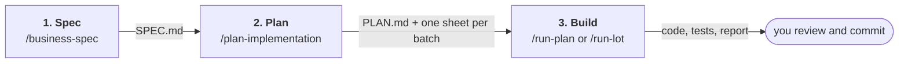
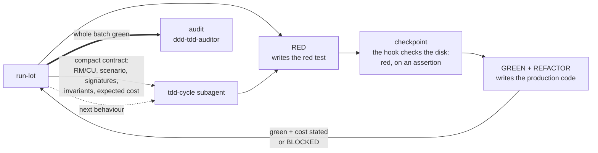
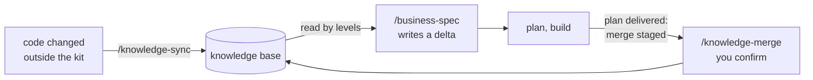

# Claude Code Toolkit

**From a business need to tested, audited code — Claude Code does the work, you make the decisions.**

`cctoolkit` is a Claude Code plugin for DDD / clean-architecture repos. You describe a feature; Claude writes the spec with you, plans it, then builds it batch by batch under strict TDD and audits the result before you commit. What the product does is kept in a business knowledge base beside the code, so every new spec starts from it.

.NET first; Python, Java/Kotlin and TypeScript repos work through their layout and test tags.

## Quick start

```bash
claude plugin marketplace add pierrebelin/claude-code-toolkit --scope project
claude plugin install cctoolkit@cctoolkit --scope project
```

Restart Claude Code, then run **`/cctoolkit:kit-init`**: it reads your repo, asks a few questions and sets everything up.

Requirements, options and what `kit-init` writes: **[INSTALL.md](INSTALL.md)**.

## How it works

Three commands, one per step. Each one writes a file the next one reads.



1. **`/cctoolkit:business-spec`** — Claude asks you one question at a time, then writes a short business spec: rules, use cases, no technical detail. A second agent tries to poke holes in it.
2. **`/cctoolkit:plan-implementation`** — turns the spec into a technical plan, split into small batches.
3. **Build** — each batch on its own: tests first, then code, then an audit. Two ways to go through the plan: all at once, or one batch at a time.

### The whole plan, or batch by batch

| | Whole plan | Batch by batch |
|---|---|---|
| Command | `/cctoolkit:run-plan <plan>` | `/cctoolkit:run-lot <sheet>` |
| Runs | every batch, in dependency order | one batch |
| You step in | once, at the end | after each batch: review, `/clear`, next |
| Stops | a batch that cannot pass is set aside, only its dependents wait; batches set aside for one shared cause stop the plan | the batch comes back `DONE`, or with what needs your eyes |
| Fits | a plan you trust, a run over lunch or overnight | a new plan, a tricky batch, a team that reviews every commit |

**Whole plan** runs the batches in the order the plan allows. Nothing waits for you: an ambiguity is decided by the agent that meets it, and what was decided without you opens the run report, to read after the plan. A batch that still cannot pass is set aside with its partial work saved, the next run picking it up where it stopped, and the batches that do not depend on it carry on. Each batch that passes gets its own commit; you review them together at the end.

**Batch by batch** keeps you in the loop: each batch ends on a report and its own commit, you read it and start the next one with a clean context.

On a new plan, or a batch you are unsure of, go batch by batch until the first ones come back clean.

Inside `run-lot`, each behaviour of the batch is one loop:



The orchestrator writes neither tests nor code: it splits the work, checks the reports and settles the design. One agent per behaviour writes the failing test, passes a checkpoint read off the disk, then makes it pass; a test it changes after that checkpoint is recorded with its assertions and judged by the audit. Another agent audits.

A batch that stops short: fix the cause and run `/cctoolkit:run-lot` on the same sheet again, it resumes from the cycles already done. `/cctoolkit:implement-tdd` launches the chain from a plan path, `/cctoolkit:verify-ddd-tdd` audits a batch on demand.

Want to see the files? **[`examples/`](examples/README.md)** walks one small feature from spec to report.

## A business knowledge base beside the code

What the product does and why lives in the repo, under `docs/business/` by default: one folder per bounded context, one file per use case with its rules, the business decisions, the ADRs, and a history of every change. Each use case, rule and decision has a global id (`CAT-RM-003`) that the specs and plans cite.



- **`/cctoolkit:knowledge-sync`** builds the base from your code the first time, then catches up with what changed outside the kit. Nothing is written until you confirm.
- **`/cctoolkit:business-spec`** reads the base first and writes the spec as a delta: what the feature adds, changes or retires.
- When a whole plan is delivered, `run-plan` stages the merge; **`/cctoolkit:knowledge-merge`** shows the diff and writes it on your word.
- **`/cctoolkit:ask`** answers how the product behaves, or why, from the base, each fact cited by its id.

The base is plain Markdown, so you can review and commit it like code. The worked example is under [`examples/docs/business/`](examples/docs/business/INDEX.md).

## Watch it run

A batch takes tens of minutes and a dozen agents, a whole plan several times that. The **`run-lot-pane`** mod shows it live inside Claude Code. On a plan, it opens on the plan: each batch with its state, time and tokens, and the supervisor checking between batches.


Open a batch and it shows each phase, which agent is working, the tests going red then green, the tokens spent, and the final verdict. The pane also steers the run: review what it decided without you, leave a note for a batch's agents ([keys](mods/README.md#run-lot-pane--follow-an-autonomous-batch)).


```bash
claude plugin install run-lot-pane@cctoolkit --scope project
```

Two more mods — a browser of the knowledge base that spends no model context and shows the spec live as it's written, and a context meter telling you when to `/clear`: [`mods/README.md`](mods/README.md).

## Opinionated by design

This kit encodes one way of working. It will:

- write the test before the code, every time;
- keep changes surgical — no drive-by refactors;
- tie every business rule to the tests that cover it;
- **one commit per `DONE` batch, nothing else** — the workflow commits the batch files only, your earlier changes stay out; never a push.

If your team works differently, half of it will feel like noise. Full list: [`skills/README.md`](skills/README.md#what-the-kit-imposes-on-the-repo).

## Learn more

| | |
|---|---|
| Install, update, dependencies | [INSTALL.md](INSTALL.md) |
| A feature from spec to report | [`examples/`](examples/README.md) |
| The knowledge base's format | [`knowledge-format.md`](skills/knowledge-sync/references/knowledge-format.md) |
| Every skill and agent | [`skills/README.md`](skills/README.md) |
| Layouts and configuration | [`presets/README.md`](presets/README.md) |

## Licence

[MIT](LICENSE). Take what you want, closed-source projects included.
