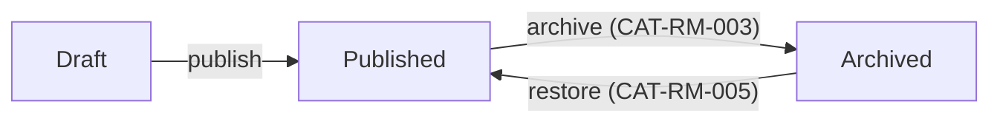

# Catalog

Catalog holds the products an organisation sells and their lifecycle, from draft to archive. It is the only source of what customers find in the catalogue listing; every product is visible to its own organisation only (CAT-RM-001).

## Vocabulary <!-- kit:vocabulary -->

<!-- kit:cols term,definition -->
| Term | Definition |
|------|------------|
| Product | Item an organisation sells |
| Catalogue listing | The published products of an organisation, sorted by name |
| Archived product | Product withdrawn from the catalogue, kept read-only for history |
| Catalogue manager | User allowed to change the lifecycle of the organisation's products |

## Lifecycle

Only published products are listed (CAT-RM-004); an archived product stays readable by its id (CAT-D-001).

## Key aggregates

- `Product` — name, organisation, `Status`: `Draft`, `Published`, `Archived`.

## Relations <!-- kit:relations -->

- Studio — diagrams reference products by id; an archived product keeps displaying in them, unchanged.
