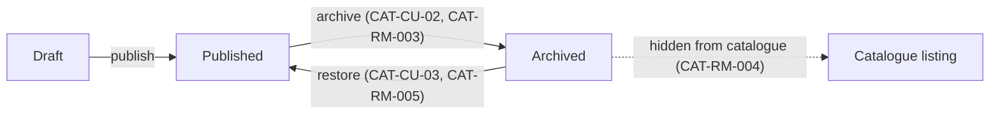

# PRD-ARCH — Product archiving

> A catalogue manager archives a published product that is no longer sold, and can restore it later. Archived products leave the catalogue but keep their history, so past orders and diagrams stay readable.

## 1. Context <!-- kit:context -->

Products that are no longer sold can only be deleted today, which breaks the diagrams and orders that reference them. Catalogue managers keep obsolete products published instead, and customers keep finding them in the catalogue.

## 2. Vocabulary <!-- kit:vocabulary -->

| Term | Definition |
|------|------------|
| Archived product | Product withdrawn from the catalogue, kept read-only for history |
| Catalogue manager | User allowed to change the lifecycle of the organisation's products |

## 3. Overview <!-- kit:overview -->

## 4. Use cases <!-- kit:use-cases -->

### CAT-CU-02 — Archive a product <!-- kit:new -->

**Actor** catalogue manager · **Intent** withdraw a product no longer sold without losing its history · **Frequency** a few times a month

**Nominal scenario:**
1. The manager opens a published product of their organisation.
2. They ask to archive it.
3. The product becomes archived and leaves the catalogue listing.

**Errors:** product not published → refused (CAT-RM-003); product of another organisation → reported as not found (CAT-RM-001).

### CAT-CU-03 — Restore an archived product <!-- kit:new -->

**Actor** catalogue manager · **Intent** put back on sale a product archived by mistake · **Frequency** rare

**Nominal scenario:**
1. The manager opens an archived product.
2. They ask to restore it.
3. The product is published again and reappears in the catalogue listing.

**Errors:** product not archived → refused (CAT-RM-005); product of another organisation → reported as not found (CAT-RM-001).

### CAT-CU-01 — Consult products <!-- kit:modified -->

**Changes:** the catalogue listing now applies CAT-RM-004; reading one product by its identifier still returns it when archived.

## 5. Business rules <!-- kit:business-rules -->

### CAT-RM-003 — Only a published product can be archived <!-- kit:new -->
- **Statement**: archiving a draft or an already archived product is refused · **Origin**: product choice · **Severity**: blocking
- **Applies to**: CAT-CU-02

### CAT-RM-004 — An archived product is absent from the catalogue listing <!-- kit:new -->
- **Statement**: the catalogue listing returns published products only; an archived product stays readable by its identifier · **Origin**: product choice · **Severity**: blocking
- **Applies to**: CAT-CU-01, CAT-CU-02, CAT-CU-03

### CAT-RM-005 — Only an archived product can be restored <!-- kit:new -->
- **Statement**: restoring a product that is not archived is refused · **Origin**: product choice · **Severity**: blocking
- **Applies to**: CAT-CU-03

## 7. States & transitions <!-- kit:states -->

| State | Event | Next state | Condition |
|-------|-------|------------|-----------|
| Published | archive | Archived | CAT-RM-003 |
| Archived | restore | Published | CAT-RM-005 |

## 9. Relations <!-- kit:relations -->

| Upstream | Downstream |
|----------|------------|
| Product publication (existing) | Catalogue listing filters on the lifecycle state |

## 10. Out of scope <!-- kit:out-of-scope -->

| Exclusion | Reason |
|-----------|--------|
| Archiving several products at once | No demand yet; one at a time covers the need |
| Notifying customers of an archived product | Handled by the marketing team, outside the product |

## 11. Assumptions <!-- kit:assumptions -->

| # | Assumption | To be validated by |
|---|------------|--------------------|
| 1 | Diagrams referencing an archived product keep displaying it, unchanged | Product owner |

## 12. Open questions <!-- kit:open-questions -->

<!-- kit:cols n,severity,question,impact,options -->
| # | Severity | Question | Impact | Options |
|---|----------|----------|--------|---------|
| 1 | Major | May a product sitting in an order not yet delivered be archived? | A refusal would add a rule to CAT-CU-02 | Yes, the order keeps it (recommended) / No, refused until delivery |

## 13. Decisions <!-- kit:decisions -->

### CAT-D-001 — Archive instead of delete <!-- kit:new -->
Choice: an archived product stays in the database, hidden from the catalogue listing.
Why: past orders and diagrams must stay readable.
Rejected: hard delete (breaks history); restore limited in time (no demand).
Links: CAT-RM-004, CAT-CU-02, CAT-CU-03

## 14. Technical points <!-- kit:technical-points -->

<!-- kit:cols n,point,raised-by -->
| # | Point | Raised by |
|---|-------|-----------|
| T1 | How an archived product is stored, and how the listing leaves it out | CAT-D-001, CAT-RM-004 |
