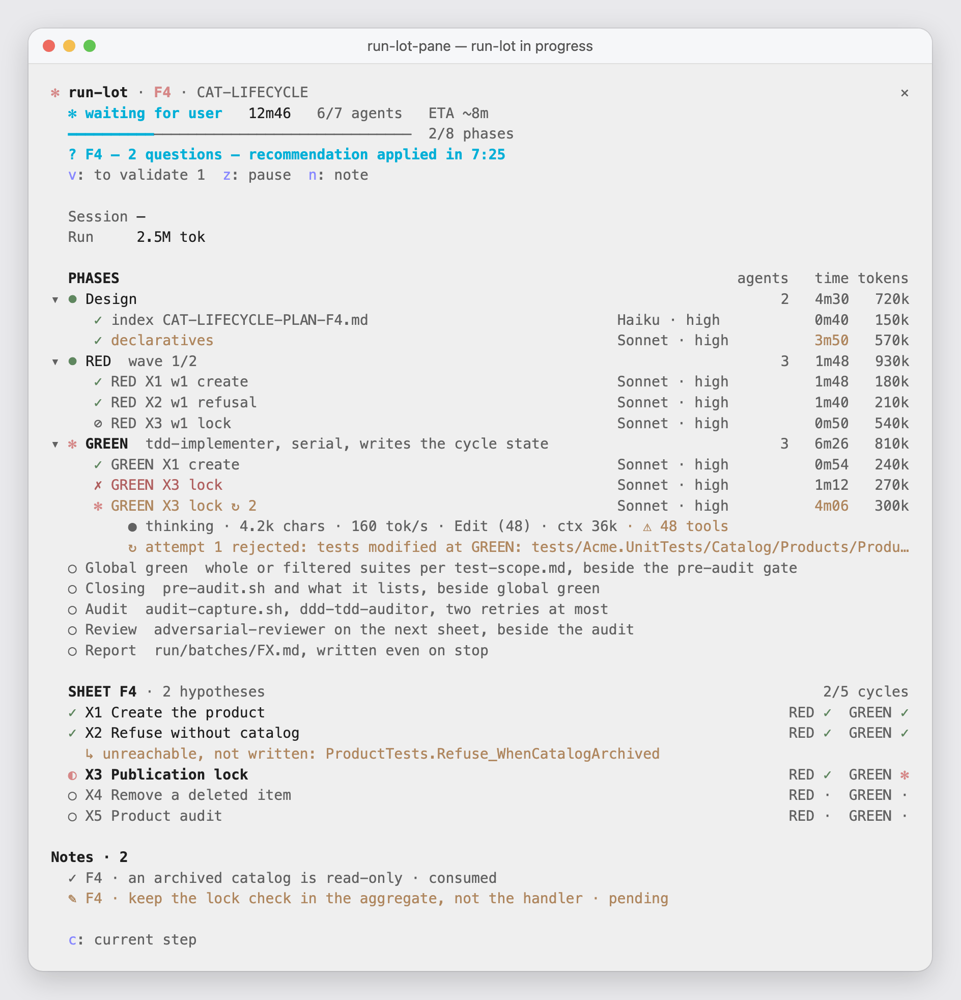
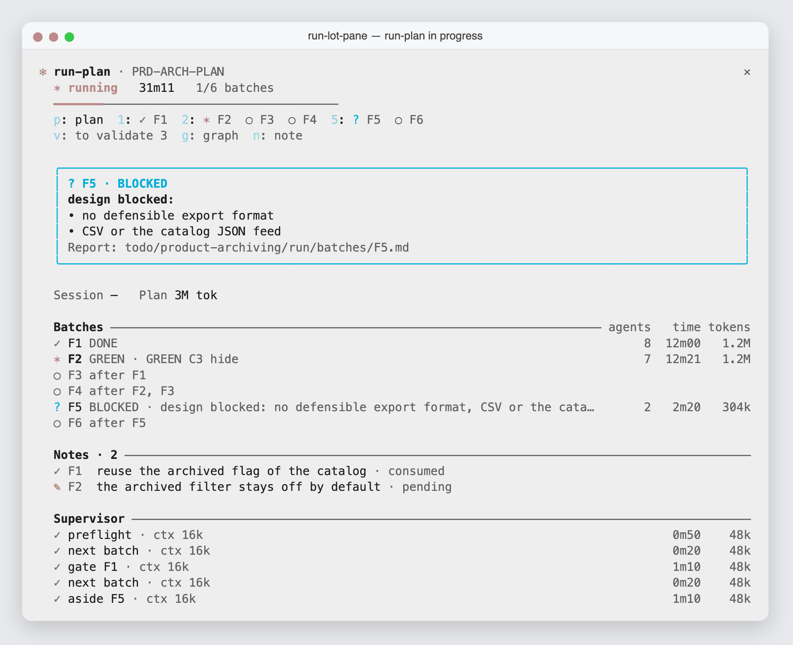
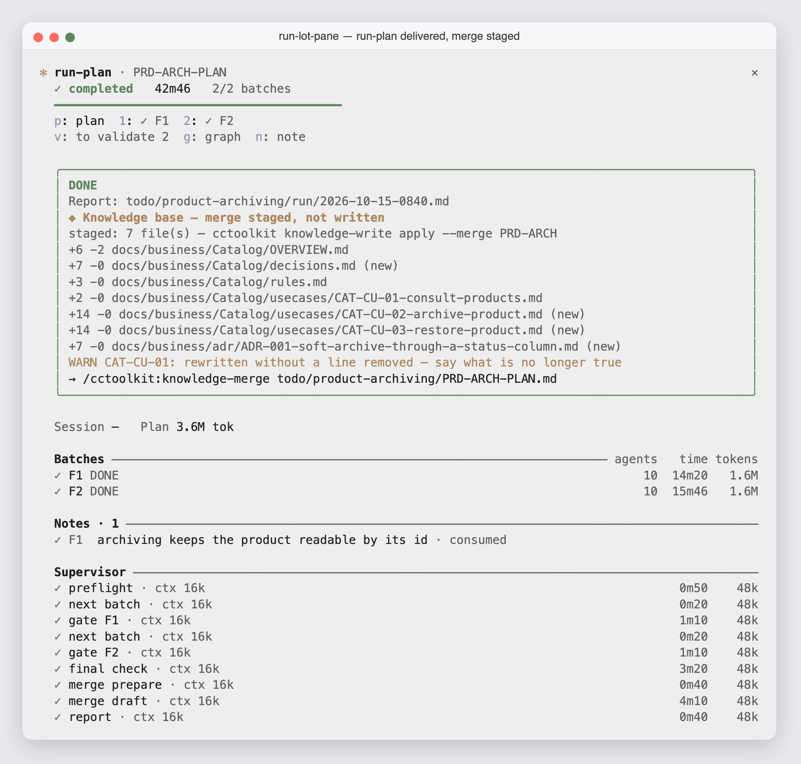
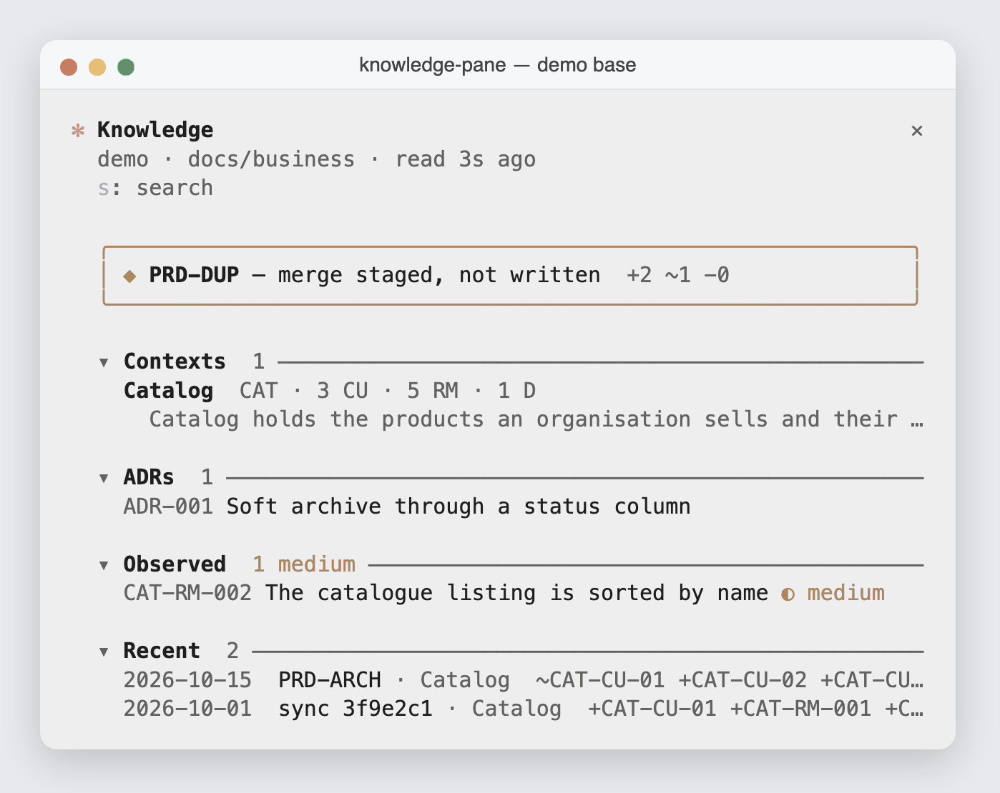
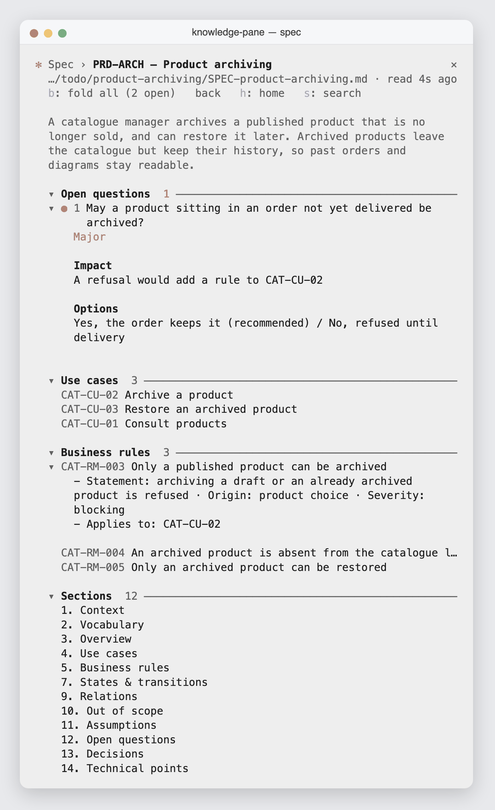
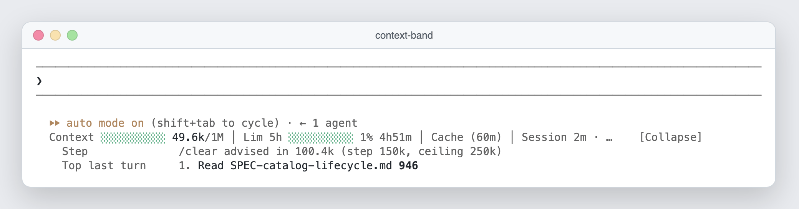

# Mods

Three optional panes drawn inside Claude Code (terminal or desktop Code tab), to see what the kit is doing without asking: where the batch stands, what the spec already holds, what the knowledge base says, how full the context is. Each one is a small plugin served by the `cctoolkit` marketplace, installed on its own — the kit works without them.

## `run-lot-pane` — follow an autonomous batch

A `/cctoolkit:run-lot` batch runs for tens of minutes across a dozen agents. The pane shows it live: phases with their agents, time and tokens, each agent's model and current tool, retries and stalls flagged as they happen, the batch sheet ticking RED → GREEN → COST (or its `## Cycles` block, each cycle done once its `cycle` line in `run/.work.jsonl` says so), an estimated end, then the outcome and the audit verdict; `c` opens the phase of the current step. Opens by itself when a Workflow starts; `/run-lot-pane demo` shows an example.



A `/cctoolkit:run-plan` run opens on the plan: batches with their state, agents, time and tokens, then the supervisor steps between them. `1`-`9` opens a batch in the view above, `p` returns to the plan; `/run-lot-pane demo plan` shows an example. A plan delivered whole — every batch `DONE`, no stop, no `--until` or `--only` — goes through a `Final check` step (every suite run whole once) and a `Merge` step (`merge prepare`, then the `knowledge-merger` agent drafting and staging the merge), and its knowledge-base merge shows under the outcome: staged and not written yet, in amber, with the files it touches, the warnings left and `/cctoolkit:knowledge-merge <plan>` to review and write it; refused, blocked or failed, in red. `/run-lot-pane demo plan merge` shows one.





The pane also steers the run through `run/.pane.jsonl`, a file the mod alone writes and the kit's scripts answer in `run/.work.jsonl`. `v` lists what the run decided without you (the `## To validate` entries of the reports, a divergence, a batch set aside, the breaker's stop, the notes taken): keep, reject or amend each one, applied at the next `/run-plan` or `/run-lot` start or at once with `cctoolkit run-validate apply <work file>`. `n` leaves a note every agent of the batch receives at its next tool call, the ones already running included, `g` draws the plan's dependency graph. A question waiting for its answer shows on every view and above the prompt, with the time left before its recommendation applies.

## `knowledge-pane` — browse the knowledge base, see the spec take shape

The business knowledge base under `knowledge.root`, browsed without spending a token of model context: the pane reads the files itself and writes nothing. The home lists the contexts of `INDEX.md` with their counts and summary, the ADRs, the objects still `observed` by level and the last `HISTORY.md` rows, and warns when a merge is prepared or staged (`partial` for a partial merge) or a sync staged, and not written yet, or when the index lags — with the command to run, `cctoolkit knowledge-index`, which the pane never launches. A context opens on its `OVERVIEW.md`, its use cases with their own rules, the cross-cutting rules, the decisions, the ADRs that cite it and its history; an object on its whole text, a use case's own rules, what it applies to, what cites it, its handlers, its `path:line` and its history rows. Every id is a row to press, `b` walks back, `h` goes home, `s` searches by id, title or handler. While the pane is open, a `cctoolkit ask --id` or `--handler` of the session shows the object it asked for. A staged merge lists its objects, `+` new, `~` modified, `−` retired, each opening on the base as it is, the staged text (or the draft) beneath it. `/knowledge-pane [Context|id|words]` opens it; `/knowledge-pane demo` shows the kit example with a staged merge; while it is shown, the pane neither follows `cctoolkit ask` nor checks the index against the files. In Claude Desktop's Code tab, a `◫ Knowledge` button above the prompt opens and closes it, and a context opens on a matrix of its use cases by the rules they apply, observed ones in amber.



During a `/cctoolkit:business-spec`, the pane switches to the spec: the decisions you answered, the open questions by severity, the use cases, business rules and sections in view, refreshed on every write. A click unfolds a row in place, `b` folds them back, then walks back to the view under the spec; the home lists the spec followed. Opens by itself when the skill starts or a spec is written; `/spec-pane <path>` follows an existing spec, `/spec-pane clear` forgets it. In Claude Desktop's Code tab, the spec state heads it: side by side, a square per open question by severity and per decision kept, changed, without an answer or pending, the question or the answer on hover; the outline gives each part its count; the button above the prompt reads `◫ Spec` while the spec is on top.



## `context-band` — know when to `/clear`

A line under the prompt, above it in Claude Desktop's Code tab: context meter, 5h limit, prompt-cache expiry, session time and cost. `▸ details` adds the `/clear` step (150k, ceiling 250k) and what filled the context over the last turns. Always on.

In Claude Desktop's Code tab the three panes draw for the desktop rather than as terminal text: drawn bars instead of block glyphs, a type scale, spacing in place of `│` and `⎿`, real buttons (`Details`, `Back`, `Close`, `Note`…), and the knowledge base's texts as Markdown. In a terminal they read the same way in a fixed face: colour is kept for state (a glyph or a signal, never a name, so `RED`, `GREEN` and the batches stay in the text colour), done in the text colour with a green `✓`, running in bold behind the spinner, to come dimmed; each block opens on a bold title and a dim rule to the pane's edge, a blank line apart, its rows at one column per level and its figures (agents, time, tokens) right-aligned in columns that a label is cut to fit, never the figures; only what waits on you is framed (a run's outcome, a plan stopped, a knowledge-base alert); a long detail is cut with `…`, a wrapped line hangs under its first.



## Install

From the repo root, type it yourself — the auto-mode classifier refuses an agent enabling plugins. The marketplace is the kit's own: skip the first line if `cctoolkit` is already installed (`INSTALL.md`).

```bash
claude plugin marketplace add pierrebelin/claude-code-toolkit --scope project
claude plugin install context-band@cctoolkit --scope project
claude plugin install knowledge-pane@cctoolkit --scope project
claude plugin install run-lot-pane@cctoolkit --scope project
```

Take only the ones you want, then restart Claude Code in the repo. Inside a session, `/plugin install <mod>@cctoolkit` does the same.

A repo that installed them from `.claude/mods/` (the former `pierrebelinmods` marketplace): `/cctoolkit:kit-init` removes that marketplace and tells which mods to reinstall.

Check it loaded:
```bash
claude -p "ok" --max-turns 1 --debug --debug-file /tmp/mods.log >/dev/null
grep 'hooks module' /tmp/mods.log   # one "loaded" line per mod
```

## Reference

Each folder is one plugin, listed beside `cctoolkit` by the kit's marketplace (`.claude-plugin/marketplace.json` at the toolkit root). Mods live here and nowhere else — never under `skills/`, even though the engine would adopt a plugin folder there.

| Mod | What it shows | Opens |
|-----|---------------|-------|
| `context-band` | line under the prompt input, below Claude Code's hint line (in Claude Desktop's Code tab, a band above the prompt): context meter and tokens, prompt-cache expiry, single-call streak, graphify rebuild, 5h limit, session time, turns since `/clear` and session cost, top 2 context contributors over 5 turns (on the terminal: groups set apart by space, each meter in the colour of its state, green at rest, amber from 60 %, red from 85 %, the tokens amber from 100k and red past the 250k ceiling; the details aligned in two columns, tokens right-aligned); `▸ details` unfolds the `/clear` step (150k, ceiling 250k), the batching advice and the full contributor list (estimates calibrated on the turn's real growth); after a restart, turns and contributors are replayed from the transcript | by itself, every turn |
| `knowledge-pane` | side pane browsing the knowledge base under `knowledge.root` of `.claude/kit.config.json` (`docs/business` by default; read-only, nothing written, no process launched): read from `.index/knowledge.jsonl` (the index's fields, `docs/FROZEN-LITERALS.md`), `INDEX.md`, each context's `OVERVIEW.md` and `HISTORY.md`, an object's own lines in its file, `.merge/<CODE>/` and `.sync/`, again when one changes (every 3 s while the pane is shown); home: contexts (prefix, CU/RM/D counts, summary), ADRs, `observed` objects by level, the last 5 history rows, alerts — index missing, index behind N files (stamps of `.index/files.json`, the files listed on a press) with `cctoolkit knowledge-index` to run, a merge prepared or staged and not written (`partial` for a partial merge, `+n ~n −n`), a sync staged (its files on a press, `/cctoolkit:knowledge-sync`); context: `OVERVIEW.md` role then each section folded, use cases with their own rules beneath, cross-cutting rules, decisions, ADRs whose ids cite the context, the last 5 history rows; object: kind and context, `specified` or `◐ observed <level>`, `path:line`, whole text (headings bold, fenced blocks dim), a use case's own rules, applies to, handlers, cites, cited by, the history rows naming it, a retired id with the row that retired it; every id a row to press, a stack of views, `b` back, `h` home, `s` search (the field takes the keyboard; id, short id `RM-004`, title words, handler, accents and case folded, 40 results); merge: its objects by context, `+` / `~` / `−`, `no draft` flagged, each opening the base text (`Base now`) with the staged one beneath it (`Staged` once `stage` laid the whole files, `Draft` before); follow: a `cctoolkit ask --id X[,Y]` or `--handler H` of the main thread shows X (Y beneath it on the stack) or the use case listing H, while the pane is shown and not on the demo; `/knowledge-pane`, `/knowledge-pane <Context>`, `<id>` or `<words>` (search), `/knowledge-pane demo` (the kit example, `mods/knowledge-pane/demo/`, with the staged merge `PRD-DUP`; follow and the index-behind check off); desktop Code tab only, `◫ Knowledge` button above the prompt while the repo holds a base or a spec is followed (`◫ Spec` while the spec is on top), and an interactive SVG heading a context: a row per use case, a column per rule its use cases apply (own rules, then cross-cutting in bold, then other contexts'), a square where it applies, blue `specified`, amber `observed` with `h` / `m` / `l`, the rule and where it lives on hover; spec: a view on top of the stack following a `/business-spec` of the current session (read-only): decisions asked through `AskUserQuestion` with their answer (`?` pending, `✓` recommended option kept, `≠` another choice, `–` closed without an answer), then, once `todo/<code>/SPEC-<code>.md` is written and on every change (mtime every 3 s), title, summary, the open questions in full (the section anchored `<!-- kit:open-questions -->`, or `## 12. Open questions` / `## 12. Questions ouvertes` in a spec written before the anchors), by severity, names of use cases, business rules and sections; a click unfolds the full content inline under its row (several at once, a second click folds it), `fold all` (`b`) folds them all back, then `b` walks back; collapsible groups; a home row `✎ <spec title>` opens it again; `/spec-pane` opens it, `/spec-pane todo/<code>/SPEC-<code>.md` follows an existing spec, `/spec-pane clear` forgets it; French and English specs both parsed, local ids (`RM-01`) and knowledge-base ids (`CAT-RM-003`, the heading's `<!-- kit:new -->` anchor left out of the name) alike, a heading read as `lib/knowledge.py` reads it (`<id> — <title>`, the em dash only); desktop Code tab only, an interactive SVG heads the spec once a decision is asked or the spec written (open questions and decisions side by side, a block alone on the whole width; in the colours of the list below; a square per open question by severity, `✖ blocking` / `▲ major` / `● other`, the question and its impact on hover; a square per decision, `✓` recommended kept, `≠` other choice, `–` no answer, `?` pending, question, answer and recommendation on hover), and the outline gives each section its count of use cases, rules or open questions, the open questions' count in the tone of the most severe, on the terminal each block a bold title, its count and a dim rule, its toggle at the view's column and its rows one level in, a context's summary on one line cut with `…`, the alerts framed in amber with the tone on their glyph, a path cut from its start keeping its indent | `/knowledge-pane`, or the desktop button; on the spec, on its own when `/business-spec` starts or a spec is written, or `/spec-pane` |
| `run-lot-pane` | side pane following a `run-lot` Workflow run (English display, demo included; English statuses `DONE` / `BLOCKED` / `GAPS` and their French counterparts recognised, `?` for a batch with a pending question line in `run/.work.jsonl`): batch named from the sheet (F4 · CAT-LIFECYCLE), phases as columns (agents, duration, tokens) with their detail, estimated end `ETA ~14m` in the header (mean durations of earlier runs, a parallel pair counted at its maximum), phases always unfolded with their agents, agents (model · effort, live activity `● thinking · 4.2k chars` / `● output · 12k chars` / `○ waiting model 40 s` / `tool Bash 2 min` read from the model stream, current tool and context, retries `↻ 2`, slowness in yellow past 2× the phase's usual time, stalls `⚠ 48 tools` / `⚠ ctx 160k` / `⚠ idle 1m` (no chunk for 60 s, no open tool, no model wait under 120 s), interruption `⊘` of an agent still running when the run stops), each agent's tokens summed from its own model calls (prompt, cache included, and output), batch sheet (steps, RED/GREEN/COST, corrections, assumptions) re-read when its file changes, or, when the sheet carries a `## Cycles` json block, one row per cycle with its RED/GREEN state read from the batch's `cycle` lines in `run/.work.jsonl`, and each unreachable method left unwritten flagged under its cycle, RED agents labelled `RED <id> w<wave> …` and GREEN agents `GREEN <id> …` with `wave n/N` on the RED phase header (highest wave launched, N from the sheet's cycle index), audit verdict by severity, run outcome as a coloured block with reason and report path, the knowledge-base merge of a `run-plan` result beneath it (`◆ Knowledge base — merge staged, not written` in amber, `✗ Knowledge base — merge refused` / `blocked` / `failed` in red, its lines — the `staged:` line and one `+n −n <file>` per file, or the cause —, the `WARN` lines left in amber, `→ /cctoolkit:knowledge-merge <plan>`; nothing when there was nothing to merge), toast at the end of the run; `resumeFromRunId` resume followed without freezing the display (a stopped journal older than the relaunch is ignored); phase card and agent card (outcome read from the structured answer, verdict and every gap included; every tool call in order with its short argument, up to 300; errors with exit code and last output line, greyed once the agent recovered; prompt without the shared workflow frame); a `run-plan` run opens a plan view (batches from the plan's execution table, state from `run/batches/FX.md`, supervisor agents; a batch done before this run keeps the agents, time and tokens of the run that finished it, saved in the mod's `$.store` per project and batch sheet when its report reads `DONE`), `1`-`9` a batch, `p` back; `c` the phase of the current step; `/run-lot-pane demo`, `demo end`, `demo plan`, `demo plan end` or `demo plan merge` (the plan delivered whole, through `Final check` and `Merge`, its merge staged) for an example; on the desktop Code tab colour is kept for state (a running phase or batch on an orange wash, failed on red, waiting on cyan; `RED` and `GREEN` are names, never tinted), a done row in the plain text colour with `✓`, one to come dimmed, the batches above the view are buttons, a plan row holds one line, each indent is a padding, on the terminal the same three stages (a done phase `✓`, the step or cycle being worked on behind the spinner, `F4` and `RED` / `GREEN` untinted, the TDD marks' names dimmed until reached), the session and run figures on one line, `Phases`, `Batches`, `Sheet`, `Notes` and the card sections each a bold title and a dim rule, an agent one level under its phase and its live detail under its label, the supervisor's agents with their time and tokens in the figure columns, an audit contest on two lines (what was contested, then its answer), a batch's detail on one line cut with `…`, a note or a warning toned on its glyph; pending question `? F3 — 2 questions — recommendation applied in 7:32` on every view and above the prompt (countdown from the question line's `waitSeconds`, gone on its answer line or when over); audit rounds under the Audit phase (`R1 findings 5 → 2 · files 4`, contests with their answer, a diverging round in red, from the `audit-round` lines); each rejected attempt's reason under an agent's `↻ n` (`attempt` lines); `v` the entries to validate (the `## To validate` bullets of the batch and run reports, `## À valider` in an older French report, divergences, batches set aside, the breaker's stop, notes taken), each `✓ keep` / `✗ reject` / `✎ amend` with a text, pending answer, answered or applied (with the relaunch command), written to `run/.pane.jsonl` and applied by `cctoolkit run-validate apply`; `n` a note for the batch in view (on the plan, the running batch or `F3: text`), pending then consumed, delivered by the kit's `run-notes` hook; `g` on the plan the dependency graph, one node per batch coloured by state (done, running, waiting, question, set aside, blocked), edges from the plan table, red and dashed out of a batch set aside, `waiting on F2 (running)` / `blocked: F3 set aside — <reason>`, duration and tokens on hover (interactive SVG on the desktop, a text tree on the terminal) | by itself, when a Workflow starts |

Screenshots taken from the real panes, in a terminal Claude Code (tmux, 150 columns, light theme) loading the three mods from this folder (`--plugin-dir`), each pane captured with its colours (`tmux capture-pane -e`), cut to the pane and framed: `/run-lot-pane demo` (`demo-running.png`), `demo plan` (`demo-plan-running.png`), `demo plan merge` (`demo-plan-merge.png`); `/knowledge-pane demo` with `Observed` unfolded (`demo-home.png`); `/spec-pane` on the kit example's spec (`examples/todo/product-archiving/`), its open question and its first business rule unfolded (`spec.png`); `context-band` after one turn reading two files, `▸ details` unfolded (`band.png`).

A `tool.call` hook reads the tool's arguments flat on `e` (`e.skill`, `e.file_path`): there is no `e.input`.

## Layout of a mod

```
<mod>/
  .claude-plugin/plugin.json   name, version, description, "types": "./types/index.d.ts"
  hooks/hooks.json             { "modules": ["./register.tsx"] }
  hooks/register.tsx           export const register: Register = on => { ... }
  types/index.d.ts             the $.state contract (interface PluginState)
  tests/*.test.tsx             claude plugin test
  tsconfig.json                extends the engine-laid types
  .gitignore                   .claude-plugin/types/ (laid by the engine)
```

## Writing a new mod

1. Load the `plugin-authoring` skill: it names the session's dev-mods folder and turns hot reload on. Write and iterate there.
2. `claude plugin validate <mod>` and `claude plugin test <mod>` green.
3. Copy it here without the engine-laid types: `rsync -a --exclude .claude-plugin/types/ <dev-mods>/<mod>/ mods/<mod>/`, delete the dev-mods copy (two loaded copies of one name collide), add its row to the toolkit root's `.claude-plugin/marketplace.json` and to `enabledPlugins` of the toolkit's `.claude/settings.json`.
4. `claude plugin validate .` from the toolkit root to check the marketplace.

Traps met with the API: in tests, call hooks (`fs.read`, `store.get`, `ui.open`…) answer `{ value: … }`; the fallback `ui.render` returns a tree (`<Box key="engine" />`), never `null`; `$` is only passed to functions declared at module level; when the state shape changes, merge with the empty value (`{ ...EMPTY, ...stored }`), since `$.state` survives reloads; no toast, no sound.
